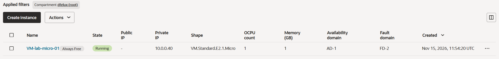
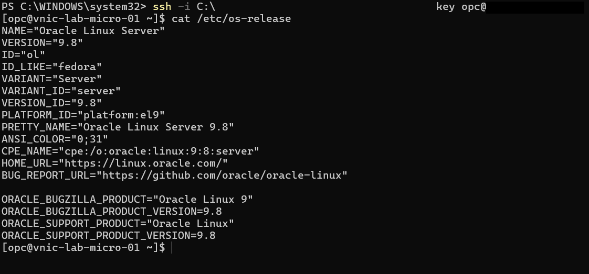
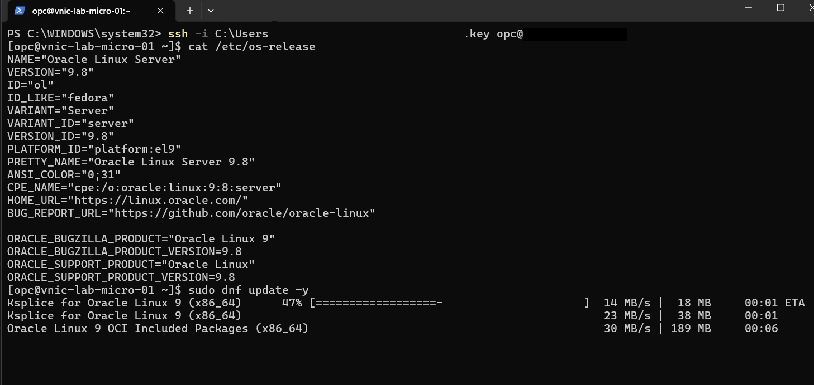
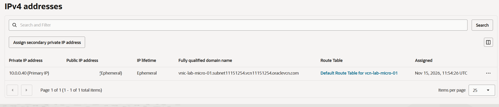

# 01 · Einrichtung: Konto, Netz, Instanz, SSH

Datum: 15.11.2026

## Ausgangslage
Erster Anmeldeversuch am Free Tier scheiterte an der Kartenprüfung („Transaction declined“). Zweiter Versuch erfolgreich.

## Schritte

1. **Budget-Warnung**: Billing & Cost Management → Budgets → Budget 1 € → Alert Rule auf *Actual Spend* mit E-Mail.
2. **Instanz erstellen** (Compute → Instances → Create instance)
   - Image: Oracle Linux 9, Build 2026.10.30-0 (neuester Build; *Autonomous* und *Minimal* bewusst nicht gewählt)
   - Shape: zuerst `VM.Standard.A1.Flex` (1 OCPU / 6 GB) → **Out of capacity** in AD-1 → Konfiguration als Stack gespeichert → Wechsel auf `VM.Standard.E2.1.Micro`
   - Security: Shielded Instance aus (Lern-VM, nachträglich nicht änderbar), Confidential Computing auf dieser Shape nicht verfügbar
   - Netz: neues VCN + neues öffentliches Subnetz (10.0.0.0/24)
   - SSH: Schlüsselpaar durch OCI erzeugt, privater Schlüssel sofort gesichert (Passwortmanager + lokales `.ssh`-Verzeichnis, nicht im Repository)
   - Speicher: Standard-Boot-Volume, In-Transit-Verschlüsselung an
3. **Öffentliche IP nachträglich zuweisen**: Bei „neues Subnetz“ ist der Schalter im Formular gesperrt, weil das Subnetz erst mit der Instanz entsteht. Lösung: VNIC → IPv4 addresses → Edit → *Ephemeral public IP*.
4. **Erster Login** (PowerShell):
   ```
   ssh -i C:\Users\User\.ssh\<schluessel>.key opc@<öffentliche-IP>
   cat /etc/os-release      # Oracle Linux Server 9.8, platform:el9
   sudo dnf update -y
   ```

## Fehlerfälle

| Fehler | Ursache | Lösung |
|---|---|---|
| Out of capacity for shape VM.Standard.A1.Flex in AD-1 | Keine freie Arm-Kapazität in der Region | Konfiguration als Stack sichern, vorerst E2.1.Micro nutzen |
| Schalter „Assign public IPv4“ ausgegraut | Subnetz existiert beim Ausfüllen noch nicht | Öffentliche IP nach dem Start an der VNIC zuweisen |

## Nachweise
Öffentliche IP in allen Bildern geschwärzt.





