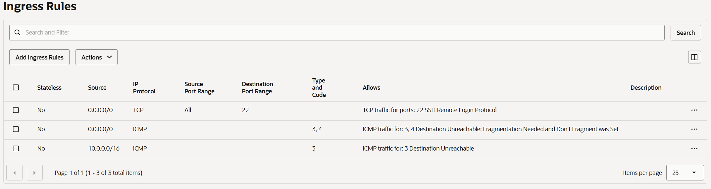
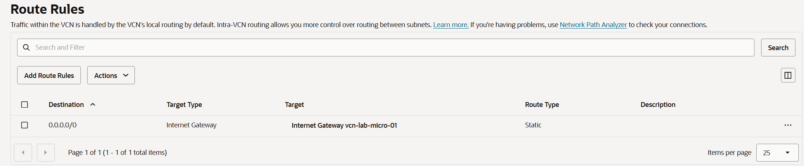
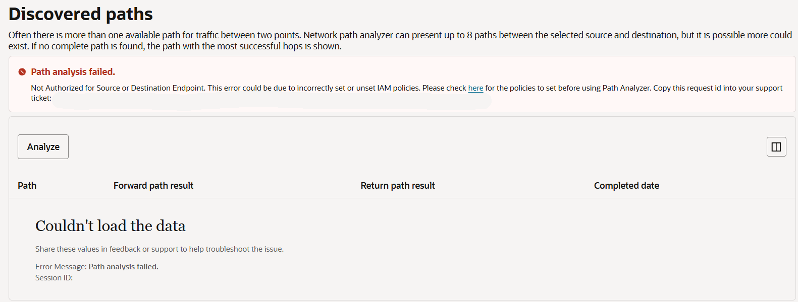
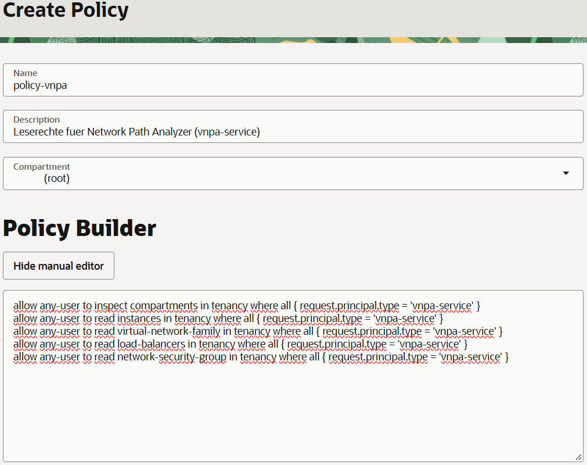
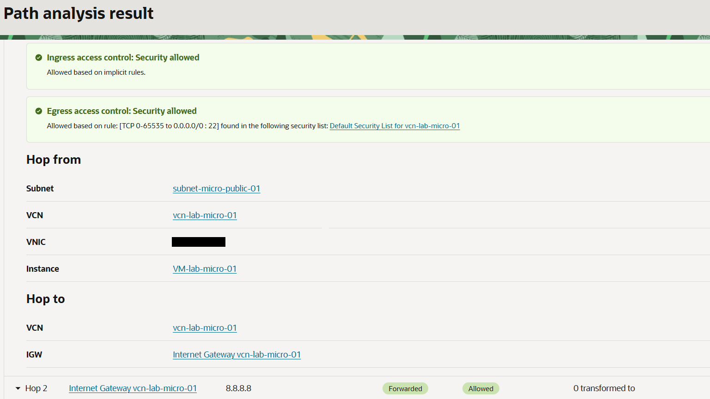
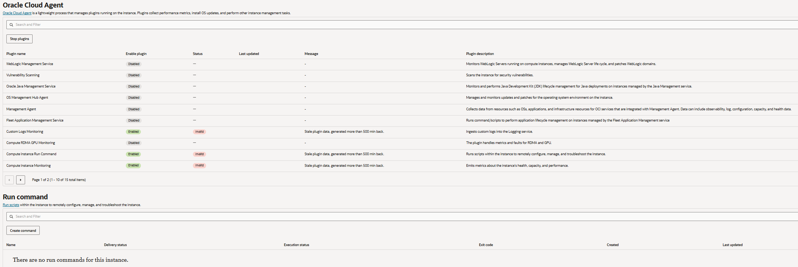

# Störung · SSH-Zugang läuft in den Timeout

Datum: 18.–19.11.2026 · Status: **geschlossen** (VM neu aufgebaut, Ursache sehr wahrscheinlich Speichermangel)

## Symptom
- `ssh -i <schluessel>.key opc@<öffentliche-IP>` → Timeout
- `Test-NetConnection <öffentliche-IP> -Port 22` → `TcpTestSucceeded : False`
- Am 15.11. funktionierte der Zugang noch.

## Eingrenzung

| Schritt | Prüfung | Ergebnis |
|---|---|---|
| 1 | Benutzername | Standardbenutzer ist `opc`; ein falscher Benutzer oder Schlüssel ergäbe `Permission denied`, keinen Timeout |
| 2 | Ping | schlägt fehl – **erwartet**: die Default Security List erlaubt nur ICMP Typ 3/4, kein Echo. Ping ist in OCI kein Erreichbarkeitstest |
| 3 | Instanzstatus, öffentliche IP | Running, IP unverändert |
| 4 | Test aus der **OCI Cloud Shell** (`nc -zv -w 5 <IP> 22`) | ebenfalls Timeout → **Heimnetz als Ursache ausgeschlossen** |
| 5 | Security List (Ingress) | TCP 22 von `0.0.0.0/0` vorhanden, dem Subnetz zugeordnet |
| 6 | Route Table | `0.0.0.0/0` → Internet Gateway, dem Subnetz zugeordnet; Subnetz public |
| 7 | VNIC | öffentliche IP an privater `10.0.0.40`, **keine NSG** |
| 8 | Reboot über das Portal | danach weiterhin Timeout |
| 9 | Console History (Boot-Protokoll) | `ens3` 10.0.0.40/24, Gateway 10.0.0.1, firewalld und sshd gestartet, Login-Prompt erreicht; `kdump` FAILED |
| 10 | Network Path Analyzer | zunächst „Not Authorized“ → IAM-Richtlinie für den Dienst `vnpa-service` angelegt |
| 11 | Path Analyzer: Internet → öffentliche IP, TCP 22 | **Hin- und Rückweg „Reachable“** → **OCI-Netz als Ursache ausgeschlossen** |
| 12 | Oracle Cloud Agent (Plugins) | alle aktiven Plugins **Invalid**: „Stale plugin data, generated more than 500 min back“ → VM meldet sich nicht mehr bei OCI |
| 13 | Monitoring (CPU/RAM) | keine Daten → bestätigt: VM kommuniziert nicht mehr nach außen |





### IAM-Richtlinie für den Network Path Analyzer
Der Path Analyzer ist ein eigener Dienst und darf Ressourcen erst nach einer Richtlinie lesen (Root-Compartment):

```
allow any-user to inspect compartments in tenancy where all { request.principal.type = 'vnpa-service' }
allow any-user to read instances in tenancy where all { request.principal.type = 'vnpa-service' }
allow any-user to read virtual-network-family in tenancy where all { request.principal.type = 'vnpa-service' }
allow any-user to read load-balancers in tenancy where all { request.principal.type = 'vnpa-service' }
allow any-user to read network-security-group in tenancy where all { request.principal.type = 'vnpa-service' }
```



### Ergebnis Path Analyzer
Erster Versuch mit Ziel = private IP `10.0.0.40`: „No route“ – **Fehler in der Fragestellung**, aus dem Internet gibt es keine Route zu einer privaten Adresse. Korrekt ist das Ziel VNIC mit der **öffentlichen** IP:

| Richtung | Hop | Ergebnis |
|---|---|---|
| Hin | Internet → Internet Gateway | Forwarded / Allowed |
| Hin | Internet Gateway → VM (NAT öffentliche IP → 10.0.0.40) | Forwarded / Allowed durch Security-List-Regel TCP 22 von 0.0.0.0/0 |
| Rück | VM → Internet Gateway | Forwarded über Route Table 0.0.0.0/0 → IGW, Egress erlaubt |
| Rück | Internet Gateway → Internet (NAT 10.0.0.40 → öffentliche IP) | Forwarded / Allowed |





## Bewertung

**Belegt**
- Das OCI-Netz ist in beide Richtungen offen (Path Analyzer).
- Die VM kommuniziert seit dem Ausfall nicht mehr nach außen (Agent-Plugins Invalid, keine Monitoring-Daten).
- Die Shape `VM.Standard.E2.1.Micro` hatte mit dem Image-Kernel nur **~500 MiB nutzbaren RAM** und ~500 MiB Swap.
- Auf der baugleichen neuen VM wurde `dnf update` reproduzierbar vom **OOM-Killer** beendet (siehe [03 · Neuaufbau](03-neuaufbau.md)).

**Wahrscheinlich, nicht beweisbar**
- Speichermangel beim/nach dem `dnf update` (15.11.) hat das Gastsystem in einen Zustand gebracht, in dem kein Netzverkehr mehr möglich war; der ungeplante Neustart am 18.11. um 08:24 Ortszeit passt dazu.

Die exakte Ursache wird nicht mehr ermittelt: ohne Konsolen-Passwort und ohne Backup hätte eine Analyse im Rettungsmodus mehr gekostet als der Neuaufbau einer Lab-VM ohne Daten (Kosten/Nutzen).

## Lösung
Neuaufbau als `VM-lab-micro-02` mit den unten genannten Vorkehrungen → [03 · Neuaufbau](03-neuaufbau.md). Alte VM gelöscht.

## Lehren
- Vor jedem Update ein **Boot-Volume-Backup** anlegen.
- **Passwort für `opc`** setzen (nur Konsole, SSH bleibt schlüsselbasiert) → serielle Konsole als Notfallzugang.
- **Run Command** vorbereiten (Dynamic Group + Richtlinie) – funktioniert aber nur, solange der Agent noch Verbindung hat.
- Auf 1-GB-Shapes **Swap erweitern** und große Repositories beim Update ausschließen.
- Befehle für die VM nicht in der Cloud Shell ausführen – die Cloud Shell ist eine eigene Umgebung.
- „Timeout“ (keine Antwort) und „Connection refused“ (Host antwortet, Port geschlossen) sauber unterscheiden.

## Vorgehen im Produktivbetrieb
Bei einer betriebsrelevanten VM wäre die Reihenfolge eine andere (Incident- vs. Problem-Management nach ITIL):

1. **Zustand sichern** – Klon/Snapshot des defekten Boot-Volumes, bevor etwas verändert wird
2. **Isolieren**, falls ein Sicherheitsvorfall nicht ausgeschlossen ist
3. **Dienst wiederherstellen** – Backup einspielen oder Neuaufbau, notfalls mit Einschränkungen (Workaround)
4. **Kommunizieren** – Betroffene über Stand und Einschränkungen informieren
5. **Ursachenanalyse** an der gesicherten Kopie, ohne Zeitdruck; dauerhafte Lösung und Postmortem

Eine tiefe Ursachenanalyse lohnt sich vor allem, wenn sich die Störung wiederholt, viele gleich gebaute Systeme betroffen sind oder kritische Daten bzw. Vorgaben (z. B. NIS2) daran hängen.
