# 03 · Neuaufbau: VM-lab-micro-02 mit Notfallvorkehrungen

Datum: 19.11.2026 · Anlass: [Störung SSH-Timeout](02-stoerung-ssh-timeout.md)

## Ausgangslage
- `VM-lab-micro-01` nicht mehr erreichbar, Ursache sehr wahrscheinlich Speichermangel nach dem Update.
- Erneuter Versuch mit Ampere A1 (gespeicherter Resource-Manager-Stack, *Apply*): **„Out of host capacity“**. Terraform hatte vor dem Fehler bereits VCN, Subnetz, Internet Gateway und Route Table angelegt → per Stack-**Destroy** wieder entfernt.
- Auffällig im Stack: `assign_public_ip = "false"` – vor einem späteren A1-Versuch anpassen.

## Schritte

1. **Instanz** `VM-lab-micro-02`: Oracle Linux 9, `VM.Standard.E2.1.Micro`, **bestehendes** VCN `vcn-lab-micro-01` / `subnet-micro-public-01`, öffentliche IP, neues Schlüsselpaar (`ssh-key-2026-11-19`, privater Schlüssel im Passwortmanager).
2. **Agent-Plugins prüfen**: Monitoring und Run Command *Running* – Gegenbeweis zur alten VM. Custom Logs Monitoring: „Not supported“ auf E2.1.Micro (Shape-Einschränkung, kein Fehler).
3. **Run Command vorbereiten**: Dynamic Group `dg-lab-runcommand` mit Regel auf das Compartment (gilt für jede künftige VM) und Richtlinie
   ```
   allow dynamic-group dg-lab-runcommand to use instance-agent-command-execution-family in tenancy where request.instance.id=target.instance.id
   ```
4. **Notfallzugang**: `sudo passwd opc` – Passwort nur für die serielle Konsole, SSH bleibt schlüsselbasiert.
5. **Boot-Volume-Backup vor dem Update**: `bv-micro-02-vor-update` (Full, manuell, 6 von 47 GB belegt).
6. **Speicher prüfen**: `free -h` → nur **498 MiB RAM**, 497 MiB Swap (`/.swapfile`), schon direkt nach dem Start 48 MiB Swap belegt.
7. **Swap um 2 GB erweitern** (dauerhaft über `/etc/fstab`):
   ```
   sudo fallocate -l 2G /swapfile2
   sudo chmod 600 /swapfile2
   sudo mkswap /swapfile2
   sudo swapon /swapfile2
   echo '/swapfile2 none swap defaults 0 0' | sudo tee -a /etc/fstab
   ```
8. **Update** (nach zwei Fehlversuchen, siehe unten):
   ```
   sudo dnf update -y --disablerepo=ol9_oci_included,ol9_ksplice --exclude=tuned*
   ```
   297 Pakete, 646 MB, Abschluss mit `Complete!`.
9. **Neustart-Test**: `sudo reboot` → zunächst `Connection refused` (Host antwortet, sshd startet noch), nach wenigen Minuten Login erfolgreich.
10. **Kontrolle**: Kernel `6.12.0-208.112.5.2.el9uek` (UEK 8), Swap 2,5 GiB nach Neustart aktiv, `sshd` und `firewalld` active.
11. **Aufräumen**: Stack-Destroy, alte VM `VM-lab-micro-01` inkl. Boot-Volume gelöscht.

## Fehlerfälle

| Fehler | Ursache | Lösung |
|---|---|---|
| `dnf update` → `Killed` | OOM-Killer: `dnf` belegte ~350 MB RAM beim Verarbeiten der Metadaten (u. a. 190 MB aus `ol9_oci_included`), trotz 2,5 GiB Swap | Große Repositories ausschließen: `--disablerepo=ol9_oci_included,ol9_ksplice` |
| Abhängigkeitskonflikt `tuned-profiles-oci` ↔ `tuned` | Folge des Workarounds: `tuned-profiles-oci` (aus `ol9_oci_included`) verlangt exakt `tuned` 2.27.0, BaseOS bietet 2.28.0; das passende neue Profil liegt im ausgeschlossenen Repository | `--exclude=tuned*`; `tuned` später gezielt zusammen mit `tuned-profiles-oci` aktualisieren. `--allowerasing` bewusst nicht verwendet (würde das OCI-Profil entfernen) |
| `Connection refused` nach Reboot | sshd beim ersten Start nach Kernel-Update noch nicht bereit | abwarten; anders als ein Timeout zeigt „refused“, dass Netz und Kernel laufen |

Beleg für den OOM-Killer:
```
sudo dmesg -T | grep -i -E "oom|killed process"
Out of memory: Killed process 9238 (dnf) total-vm:3400764kB, anon-rss:359416kB ...
```

## Beobachtung: nutzbarer RAM verdoppelt
Vor dem Update (Image-Kernel): **498 MiB** nutzbar. Nach dem Update (UEK 8): **945 MiB**. Der alte Kernel reservierte vermutlich einen großen Teil für kdump (`crashkernel`) – passend zu `kdump FAILED` im Bootprotokoll der alten VM. Prüfung offen: `cat /proc/cmdline`.

> **Nachtrag 20.11.:** Geprüft. Auch der neue Kernel bootete später wieder mit `crashkernel=1G-64G:448M` und nur 498 MiB. Die Einstellung `auto_reset_crashkernel yes` in `/etc/kdump.conf` trägt die Reservierung wahrscheinlich selbst wieder ein. kdump wurde deaktiviert und die Reservierung entfernt → [Kapitel 04](04-stoerung-dnf-makecache.md).

## Offene Punkte
- `tuned` + `tuned-profiles-oci` gezielt aktualisieren (Agent vorher stoppen)
- `ol9_oci_included` und `ol9_ksplice` ggf. dauerhaft deaktivieren
- ~~Kernel-Parameter `crashkernel` prüfen~~ → erledigt in Kapitel 04
- Nächstes Kapitel: eigener Admin-Benutzer, SSH-Härtung (jetzt Kapitel 05)

## Nachweise
Öffentliche IPs in allen Bildern geschwärzt.

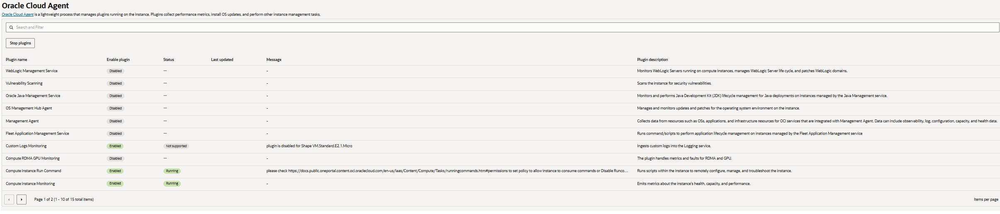
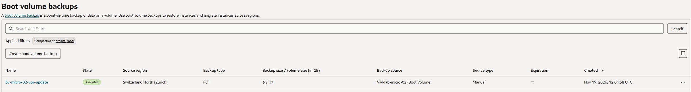
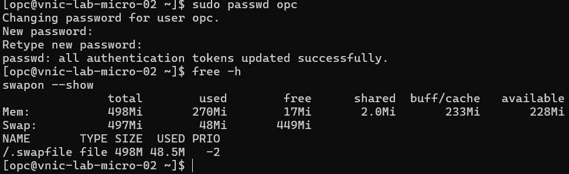
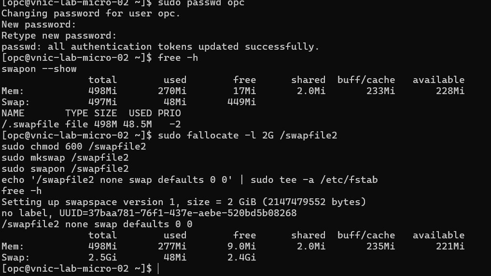
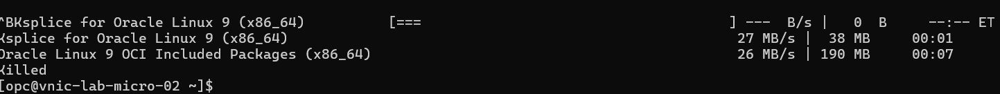
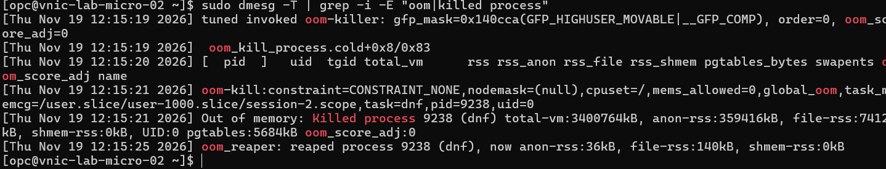
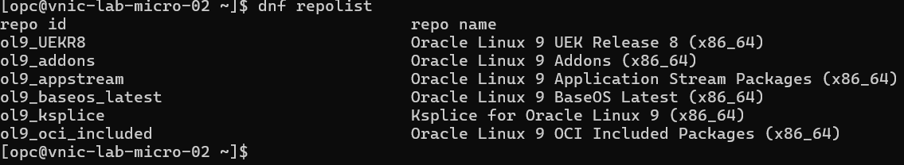
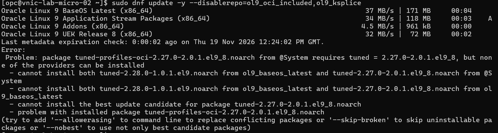
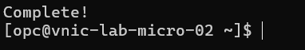
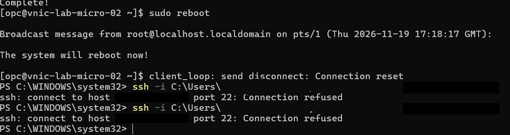
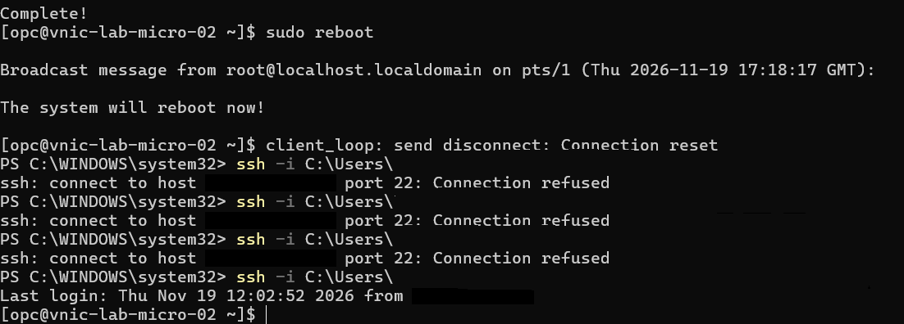
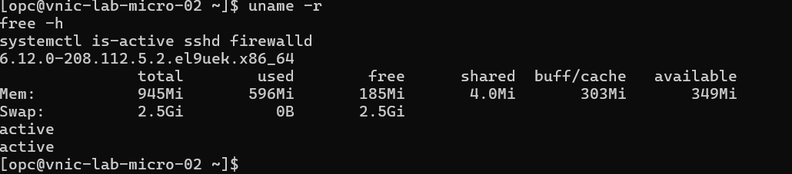
