# Störung · VM hängt wiederholt – dnf-makecache erschöpft den Arbeitsspeicher

Datum: 19.–20.11.2026 · Status: **geschlossen** (Ursache belegt, Behebung umgesetzt und geprüft)

## Symptom
- Am Morgen des 20.11.: `ssh opc@<öffentliche-IP>` → Timeout. Die Instanz steht in der Konsole auf **Running**.
- Oracle Cloud Agent: alle aktiven Plugins **Invalid**, „Stale plugin data, generated more than 500 min back“. Das ist dasselbe Bild wie bei [Störung 02](02-stoerung-ssh-timeout.md).
- Die serielle Konsole verbindet sich, zeigt aber keinen Login-Prompt.

## Vorgehen
Diesmal wurde nach dem Grundsatz „erst Zustand sichern, dann wiederherstellen“ gearbeitet. Bei Störung 02 fehlten genau diese Belege.

| Schritt | Prüfung | Ergebnis |
|---|---|---|
| 1 | Instanzstatus | Running. Das sagt nur, dass die VM eingeschaltet ist, nicht, ob das Gastsystem reagiert |
| 2 | SSH direkt (ohne `~/.ssh/config`) | Timeout → Konfigurationsfehler auf dem Client ausgeschlossen |
| 3 | Monitoring, letzte 24 h | Speicher springt viermal auf ca. 95 %, danach jeweils Datenlücken. Seit ca. 04:00 UTC keine Daten mehr |
| 4 | Monitoring: Load Average, Memory Allocation Stalls | Load bis ca. 22 auf einer vCPU bei geringer CPU-Last, bis ca. 150.000 Stalls → **Thrashing** |
| 5 | Serielle Konsole | keine Reaktion |
| 6 | **Console History** (Capture) | OOM-Killer beendet `dnf`, gestartet von `dnf-makecache.service` → **Ursache belegt** |
| 7 | Force Reboot, Anmeldung über die serielle Konsole | Timer sofort deaktiviert, bevor er rund 10 Minuten nach dem Boot erneut startet |
| 8 | Bestandsaufnahme per SSH | nur 498 MiB RAM, 180 MB Swap schon nach 6 Minuten belegt, Journal flüchtig |
| 9 | `/proc/cmdline` | `crashkernel=1G-64G:448M` → kdump reserviert fast die Hälfte des RAM |

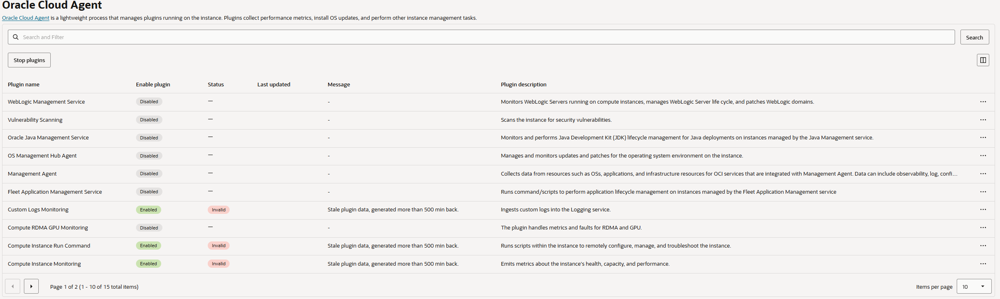

### Monitoring
Zeiten in UTC. Die Speicherspitzen liegen bei ca. 17:30, 20:30, 01:30 und 04:00 Uhr, also im Abstand von etwa 3 bis 4 Stunden. Die schrägen, geraden Linien nach jeder Spitze sind keine Messwerte. Es sind Lücken, in denen die VM nichts gemeldet hat. Dreimal hat sich das System wieder gefangen, beim vierten Mal nicht mehr.

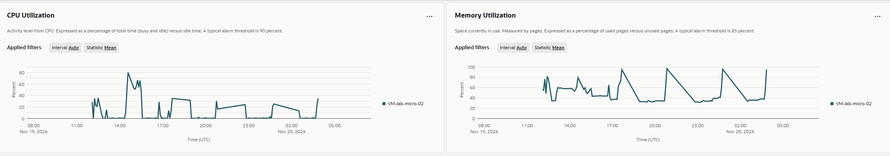

Die Load Average steigt bis ca. 22, obwohl die CPU kaum ausgelastet ist. Die Prozesse rechnen also nicht, sondern warten auf Speicher. Die Memory Allocation Stalls zeigen, wie oft der Kernel mitten in einer Anforderung selbst Speicher freimachen musste. Zusammen ist das das typische Bild von Thrashing: Der Kernel lagert ununterbrochen zwischen RAM und Swap um, für echte Arbeit bleibt nichts übrig.

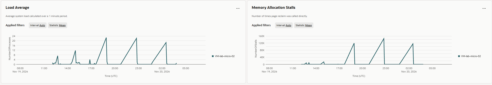

### Beleg aus der Console History
Die Console History lässt sich auch ohne Anmeldung mitschneiden. Die entscheidenden Zeilen:

```
oom-kill:constraint=CONSTRAINT_NONE,...,task_memcg=/system.slice/dnf-makecache.service,task=dnf,pid=14026,uid=0
Out of memory: Killed process 14026 (dnf) total-vm:3465896kB, anon-rss:752696kB, file-rss:6400kB, ...
```

- Der Prozess lief als `dnf-makecache.service`, gestartet vom Timer und nicht von Hand.
- Er belegte ca. **735 MiB** echten Arbeitsspeicher, bei 945 MiB nutzbarem RAM insgesamt.
- Nach dem OOM-Kill startet der Timer ihn später erneut. Daher die wiederkehrenden Spitzen.

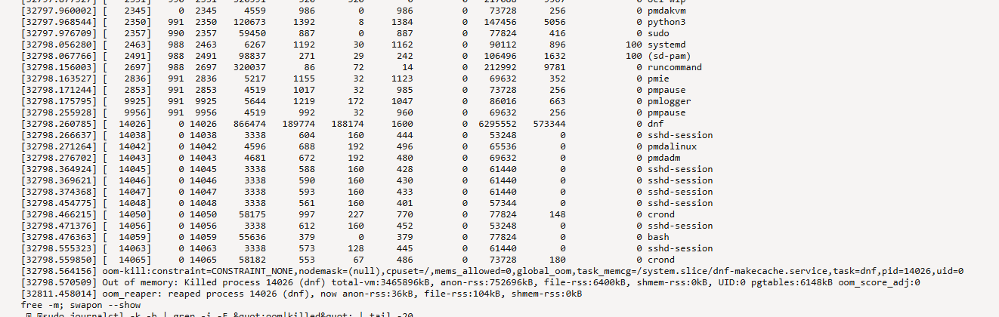

## Ursache
`dnf-makecache.timer` aktualisiert regelmäßig die Paketmetadaten im Hintergrund. Auf `VM.Standard.E2.1.Micro` (1 GB RAM) braucht `dnf` dafür mehr Speicher, als die VM hat. Der Swap von 2,5 GiB auf einem Block-Volume hat den Absturz nicht verhindert, sondern verschleppt: Statt eines schnellen OOM-Kills hat sich die VM stundenlang festgefahren.

Verschärft wurde das durch zwei Grundlasten:
- **kdump** reservierte über `crashkernel=1G-64G:448M` dauerhaft 448 MiB. Die Einstellung `auto_reset_crashkernel yes` in `/etc/kdump.conf` trägt die Reservierung automatisch wieder ein. Das erklärt, warum nach dem Update in [Kapitel 03](03-neuaufbau.md) zunächst 945 MiB, jetzt aber wieder 498 MiB zur Verfügung standen. Das ist wahrscheinlich, aber nicht im Detail belegt.
- **PCP (Performance Co-Pilot)** mit `pmcd`, `pmlogger` und `pmie` lief als zweites Monitoring neben dem Oracle Cloud Agent.

**Rückblick auf Störung 02:** Dort lautete die Bewertung „Speichermangel, sehr wahrscheinlich, nicht beweisbar“. Mit dem Beleg von heute ist dieselbe Ursache naheliegend: `dnf` passt auf dieser Shape nicht in den Speicher, ob von Hand oder vom Timer gestartet.

## Behebung

| Maßnahme | Befehl | Wirkung |
|---|---|---|
| Timer abschalten | `sudo systemctl disable --now dnf-makecache.timer` und `sudo systemctl mask dnf-makecache.timer` | Ursache beseitigt |
| kdump abschalten | `sudo systemctl disable --now kdump` | – |
| Reservierung entfernen | `sudo grubby --update-kernel=ALL --remove-args="crashkernel"` | gilt für alle Boot-Einträge |
| Wiedereintragen verhindern | in `/etc/kdump.conf`: `auto_reset_crashkernel no` | dauerhaft |
| PCP abschalten | `sudo systemctl disable --now pmcd pmlogger pmie` | weniger Grundlast |
| Journal dauerhaft speichern | `sudo mkdir -p /var/log/journal` und `sudo systemd-tmpfiles --create --prefix /var/log/journal` | `journalctl -b -1` funktioniert bei der nächsten Störung |

Vor dem Neustart wurde das Backup `bv-micro-02-vor-tuning` angelegt. Es entstand um 07:57 UTC, also nach den Konfigurationsänderungen. Alle Änderungen lassen sich mit einem Befehl zurücknehmen. Der Stand vor allen Eingriffen ist `bv-micro-02-vor-update`.

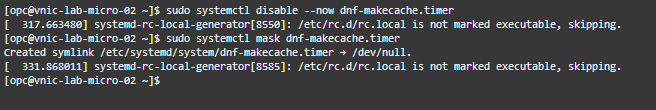
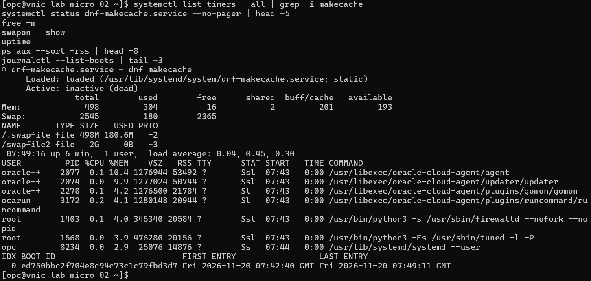
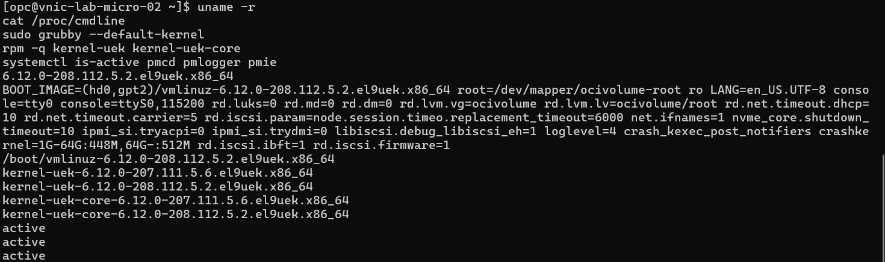
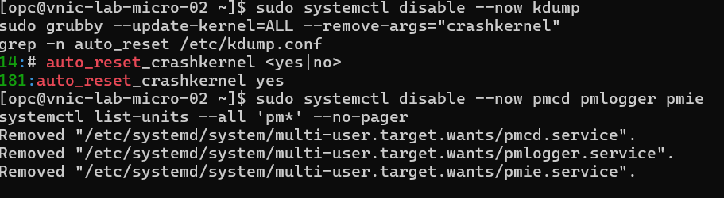
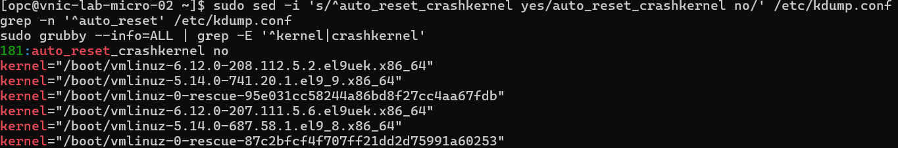
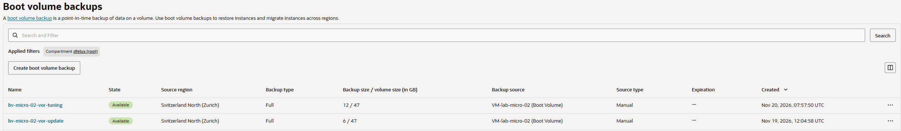

## Ergebnis nach dem Neustart

| Wert | vorher | nachher |
|---|---|---|
| Nutzbarer RAM | 498 MiB | **945 MiB** |
| Swap belegt kurz nach dem Start | 180 MB | **0** |
| `crashkernel` in `/proc/cmdline` | vorhanden | entfernt |
| PCP-Dienste | aktiv | deaktiviert |
| Journal | nur im RAM | auf der Platte (`/var/log/journal/<machine-id>`) |

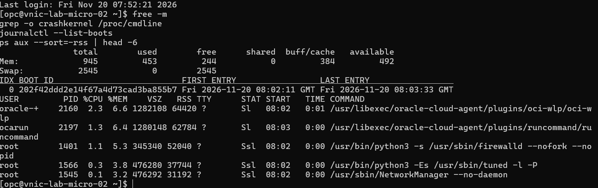
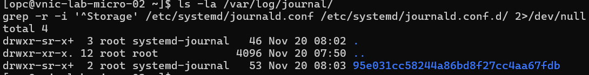

## Folgen für den Betrieb
- **Keine automatischen Updates** auf dieser Shape. Updates nur von Hand, gezielt und beaufsichtigt, mit den Repo-Ausschlüssen aus Kapitel 03 und einem Boot-Volume-Backup vorher.
- **Ohne kdump** gibt es bei einem Kernel-Absturz keinen Speicherabzug. Für eine Lab-VM ist das vertretbar. Im Produktivbetrieb wäre das eine bewusste, dokumentierte Abwägung, oder man nimmt eine Shape mit mehr RAM.
- Mehr Swap ist auf 1 GB RAM keine Lösung für einen Prozess, der dauerhaft mehr Speicher braucht, als vorhanden ist.

## Lehren
- **Zuerst Belege sichern, dann neu starten.** Monitoring-Graphen und Console History waren ohne Anmeldung verfügbar und haben die Ursache geliefert.
- Der Status **Running** sagt nichts über den Zustand des Gastsystems.
- Die Console History ist der wichtigste Beleg, wenn das Journal flüchtig ist. Besser: das Journal von Anfang an dauerhaft speichern.
- Nach einem Neustart läuft ein Wettlauf mit Timern. Für diesen Fall gibt es zwei Wege: schnell anmelden oder im GRUB-Menü einmalig `systemd.mask=dnf-makecache.timer` an die Kernel-Zeile anhängen. Den Rettungsmodus (`rescue.target`) zu verwenden, scheitert auf OCI-Images, weil Root gesperrt ist.
- In die serielle Konsole lässt sich nicht zuverlässig einfügen (Zeichen gehen verloren). Für längere Befehle so früh wie möglich auf SSH wechseln.
- Images bringen Dienste mit, die auf großen Shapes sinnvoll sind (kdump, PCP, dnf-makecache), auf 1 GB RAM aber den Betrieb gefährden. Nach dem Aufsetzen die Grundlast prüfen.
