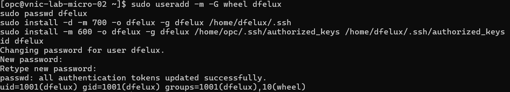
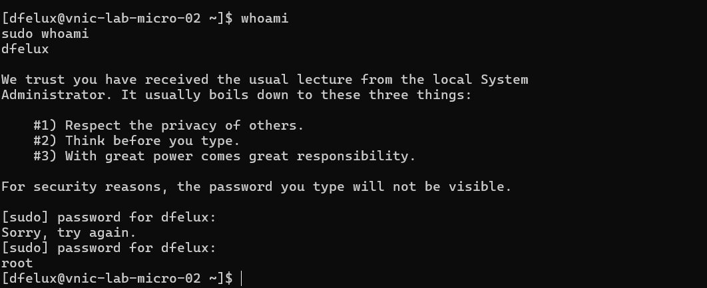
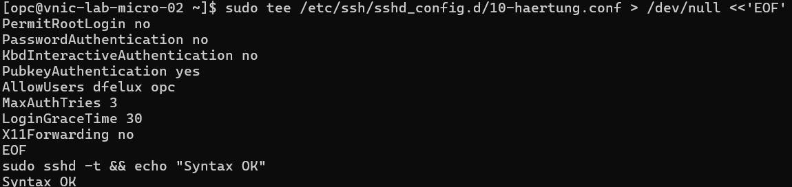
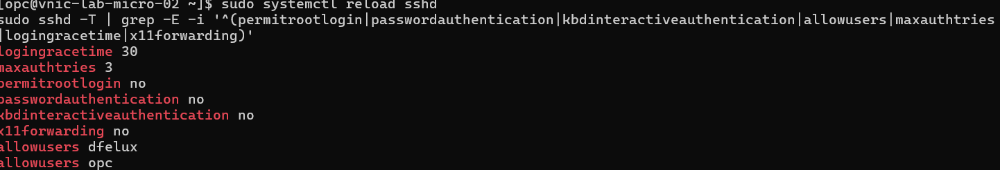
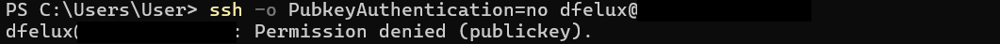

# 05 · SSH-Härtung: eigener Admin-Benutzer, nur Schlüssel, kein Root-Login

Datum: 20.11.2026 · Status: **erledigt**

## Ziel
- Eigenes Administratorkonto statt des Image-Standardbenutzers `opc`
- Anmeldung nur per Schlüssel, keine Passwort- oder Kerberos-Anmeldung
- Kein direkter Root-Login, nur ausdrücklich erlaubte Benutzer
- Weniger Angriffsfläche für die öffentlich erreichbare VM

## Grundregel: nicht aussperren
- Die bestehende SSH-Sitzung bleibt während aller Änderungen offen. Getestet wird in einem zweiten Fenster.
- Die Konfiguration wird vor dem Anwenden geprüft (`sshd -t`) und mit `reload` statt `restart` angewendet. Bestehende Sitzungen bleiben so erhalten.
- Notzugang: serielle Konsole mit dem Passwort für `opc` (siehe [Kapitel 03](03-neuaufbau.md)).

## Schritte

### 1. Admin-Benutzer anlegen
```
sudo useradd -m -G wheel dfelux
sudo passwd dfelux
sudo install -d -m 700 -o dfelux -g dfelux /home/dfelux/.ssh
sudo install -m 600 -o dfelux -g dfelux /home/opc/.ssh/authorized_keys /home/dfelux/.ssh/authorized_keys
```
- Über die Gruppe `wheel` darf der Benutzer `sudo` verwenden, und zwar **mit Passwort**. Das ist bewusst strenger als bei `opc`, der `sudo` ohne Passwort darf.
- Das Passwort dient nur `sudo`, nicht der SSH-Anmeldung.
- `install` legt Verzeichnis und Datei in einem Schritt mit Besitzer und Rechten an (700 bzw. 600). Bei zu offenen Rechten verweigert sshd den Schlüssel.
- Vorerst wird derselbe öffentliche Schlüssel wie für `opc` verwendet.



**Test im zweiten Fenster:** Anmeldung als `dfelux` per Schlüssel, `sudo whoami` → `root` nach Passworteingabe.



### 2. sshd härten
Eigene Datei statt Änderungen an `/etc/ssh/sshd_config`. So bleibt die Vorgabe des Images unangetastet und die Härtung ist an einer Stelle nachvollziehbar.

`/etc/ssh/sshd_config.d/10-haertung.conf`:
```
PermitRootLogin no
PasswordAuthentication no
KbdInteractiveAuthentication no
PubkeyAuthentication yes
AllowUsers dfelux opc
MaxAuthTries 3
LoginGraceTime 30
X11Forwarding no
GSSAPIAuthentication no
```

| Einstellung | Zweck |
|---|---|
| `PermitRootLogin no` | Kein direkter Root-Login. Administration nur über ein persönliches Konto und `sudo` (nachvollziehbar, wer was getan hat) |
| `PasswordAuthentication no`, `KbdInteractiveAuthentication no` | Keine Passwort-Anmeldung. Passwortraten (Brute Force) läuft ins Leere |
| `GSSAPIAuthentication no` | Kerberos-Anmeldung aus. Auf Oracle Linux standardmäßig aktiv, hier ohne Nutzen |
| `AllowUsers dfelux opc` | Nur diese beiden Konten dürfen sich anmelden. `opc` bleibt vorerst als zweiter Weg erhalten |
| `MaxAuthTries 3`, `LoginGraceTime 30` | Weniger Versuche und kürzere Zeit pro Verbindung |
| `X11Forwarding no` | Keine grafische Weiterleitung, auf einem Server nicht benötigt |

**Reihenfolge der Konfigurationsdateien:** sshd liest die Dateien in `sshd_config.d/` alphabetisch, und bei den meisten Optionen **gilt der erste gefundene Wert**. Das Präfix `10-` sorgt dafür, dass die Härtung vor der Vorgabe des Images (`50-redhat.conf`) gelesen wird.

```
sudo sshd -t && echo "Syntax OK"
sudo systemctl reload sshd
```



### 3. Wirksame Werte prüfen
`sshd -T` zeigt die Konfiguration, die tatsächlich gilt, nach Auswertung aller Dateien. Das ist der Nachweis, dass keine andere Datei die Härtung überschreibt.

```
sudo sshd -T | grep -E -i '^(permitrootlogin|passwordauthentication|kbdinteractiveauthentication|allowusers|maxauthtries|logingracetime|x11forwarding|gssapiauthentication)'
```



### 4. Test von außen

| Test | Erwartung | Ergebnis |
|---|---|---|
| `ssh -i <schluessel> dfelux@<öffentliche-IP>` | Anmeldung | erfolgreich |
| `ssh -o PubkeyAuthentication=no dfelux@<öffentliche-IP>` | Abweisung | `Permission denied (publickey)` |

Die Meldung der Gegenprobe nennt nur noch `publickey`. Vor dem Abschalten von GSSAPI bot sshd zusätzlich `gssapi-keyex` und `gssapi-with-mic` an.



### 5. Client-Konfiguration
Zwei Kurznamen in `C:\Users\<benutzer>\.ssh\config`, damit `ssh oracleadmin` bzw. `ssh oracle` genügt:
```
Host oracleadmin
    HostName <öffentliche-IP>
    User dfelux
    IdentityFile C:\Users\<benutzer>\.ssh\<schluessel>.key
    ServerAliveInterval 60
    ServerAliveCountMax 3

Host oracle
    HostName <öffentliche-IP>
    User opc
    IdentityFile C:\Users\<benutzer>\.ssh\<schluessel>.key
    ServerAliveInterval 60
    ServerAliveCountMax 3
```
- `oracleadmin` (eigenes Konto, `sudo` mit Passwort) ist der Weg für die tägliche Administration.
- `oracle` (`opc`) bleibt der Rückfallweg, solange `opc` noch erlaubt ist.
- `ServerAliveInterval` hält die Verbindung bei Pausen offen.
- Die Datei hat keine Endung. Notepad hängt beim Speichern gern `.txt` an, dann findet SSH sie nicht (`Could not resolve hostname oracle`).

## Bewusst nicht umgesetzt (noch)
- **Eigener Schlüssel für `dfelux`**: Derzeit teilen sich beide Konten einen Schlüssel. Sauberer ist ein eigenes Schlüsselpaar pro Person.
- **`opc` aussperren**: Erst wenn der neue Zugang einige Zeit zuverlässig läuft. Die serielle Konsole bleibt als Notzugang.
- **SSH-Port ändern**: verringert nur Rauschen im Log, keine echte Sicherheit. Wirksamer ist, die Security List auf die eigene IP zu beschränken → Kapitel 06.
- **Fail2ban**: bei reiner Schlüssel-Anmeldung wenig Mehrwert, kostet auf 1 GB RAM Speicher.
- **Cockpit** (Web-Konsole, Hinweis beim Login): bleibt aus, sonst ein weiterer Anmeldedienst im Internet.

## Lehren
- Befehle, die eine Eingabe erwarten (`passwd`, `sudo` mit Passwort), einzeln ausführen. Beim Einfügen eines ganzen Blocks kann die Eingabeaufforderung nachfolgende Zeilen als Eingabe lesen.
- Konfiguration erst mit `sshd -t` prüfen, dann `reload`. Die tatsächliche Wirkung mit `sshd -T` belegen, nicht aus der Datei ablesen.
- Härtung immer mit Gegenprobe testen: Was verboten sein soll, muss auch tatsächlich abgewiesen werden.
