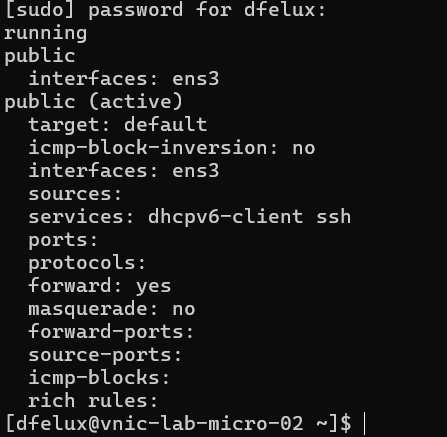
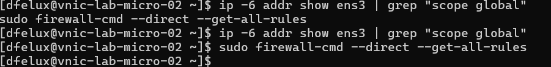
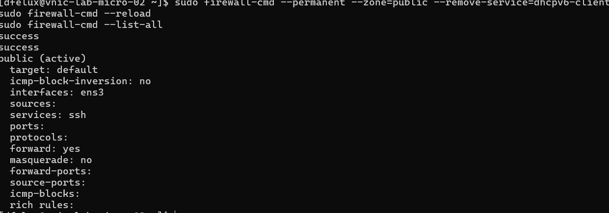
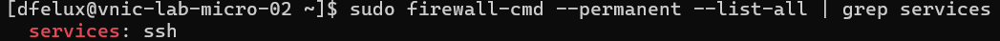
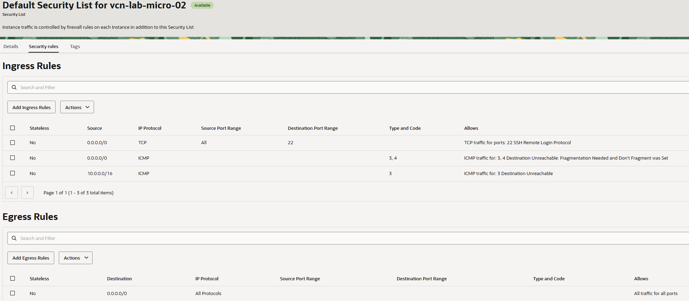
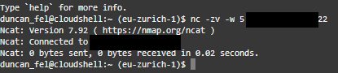
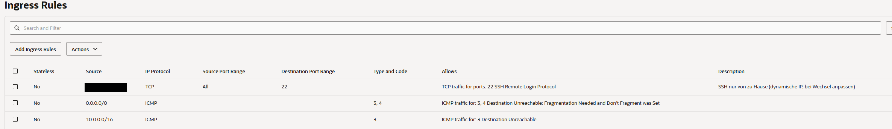
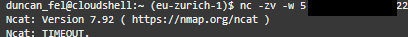
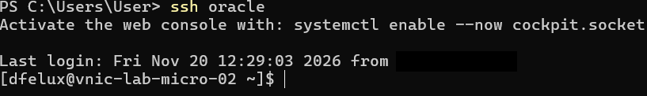

# 06 · Host-Firewall mit firewalld, Security List auf die eigene IP

Datum: 20.11.2026 · Status: **erledigt**

## Ziel
- SSH ist der einzige Dienst, der von außen erreichbar sein soll.
- Zwei unabhängige Filter: die **Security List** am Rand des Netzes (OCI) und **firewalld** auf der VM. Fällt eine Ebene durch einen Fehler weg, schützt die andere weiter.
- SSH nicht mehr für das ganze Internet offen, sondern nur für die eigene Adresse.

## Grundregel: nicht aussperren
- Eine zweite SSH-Sitzung bleibt während der Änderungen offen. Bestehende Verbindungen überleben auch eine falsche Regel.
- Die Security List lässt sich jederzeit in der OCI-Konsole zurücksetzen, auch wenn SSH gesperrt ist. Aussperren kann man sich damit nur aus SSH, nicht aus der Verwaltung.
- Weitere Rückwege: serielle Konsole ([Kapitel 03](03-neuaufbau.md)), Boot-Volume-Backup.

## 1. firewalld auf der VM

### Ausgangslage
```
sudo firewall-cmd --state
sudo firewall-cmd --get-active-zones
sudo firewall-cmd --list-all
```
firewalld läuft bereits (Oracle-Linux-Image). Zone `public` an `ens3`, `target: default` (alles Nicht-Erlaubte wird abgewiesen), offen sind `dhcpv6-client` und `ssh`.



### Ist `dhcpv6-client` nötig?
Nur wenn die VM per DHCPv6 eine IPv6-Adresse bezieht. Außerdem wurde geprüft, ob das Image eigene Direct-Rules mitbringt (etwa für den Metadatendienst), die erhalten bleiben müssen.
```
ip -6 addr show ens3 | grep "scope global"
sudo firewall-cmd --direct --get-all-rules
```
Beides leer: keine globale IPv6-Adresse, keine Direct-Rules. Der Metadatendienst ist ohnehin nicht betroffen, weil die VM diese Verbindungen selbst nach außen aufbaut.



### Umsetzung
```
sudo firewall-cmd --permanent --zone=public --remove-service=dhcpv6-client
sudo firewall-cmd --reload
sudo firewall-cmd --list-all
sudo firewall-cmd --permanent --list-all | grep services
```
Laufend und dauerhaft ist nur noch `ssh` erlaubt. Eine neue Anmeldung in einem dritten Fenster funktionierte, erst danach wurde die Reserve-Sitzung geschlossen.




## 2. Security List auf die eigene IP

### Ausgangslage
*Default Security List* des VCN: SSH (TCP 22) von `0.0.0.0/0`, ICMP Typ 3 Code 4 von überall (Path-MTU-Erkennung), ICMP Typ 3 aus dem eigenen VCN; ausgehend alles erlaubt.



Negativtest **vorher** aus der OCI Cloud Shell, die über eine öffentliche IP von Oracle und damit von einer fremden Adresse kommt:
```
nc -zv -w 5 <öffentliche-IP-der-VM> 22
```
Ergebnis: `Connected` – Port 22 ist für jeden erreichbar.



### Welche Adresse?
Die „statische IP“ in der FRITZ!Box ist nur die Adresse im Heimnetz (192.168.x.x). Die Security List sieht die **öffentliche IPv4**, die der Anschluss vom Provider bekommt. Hier: echte IPv4 (kein DS-Lite, also nicht mit anderen Kunden geteilt), dynamisch, ohne tägliche Zwangstrennung. Sie bleibt, bis der Router neu verbindet.

### Umsetzung
Ingress-Regel für TCP 22 bearbeitet:
- **Source CIDR:** `<eigene-IP>/32`
- **Description:** „SSH nur von zu Hause (dynamische IP, bei Wechsel anpassen)“
- ICMP-Regeln unverändert: Ohne Typ 3 Code 4 kann die Path-MTU-Erkennung scheitern, dann hängen Verbindungen bei großen Paketen.



### Nachweis
| Test | Vorher | Nachher |
|---|---|---|
| Cloud Shell (fremde IP): `nc -zv -w 5 <VM-IP> 22` | `Connected` | `TIMEOUT` |
| Zu Hause: `ssh oracle` | ok | ok, „Last login … from `<eigene-IP>`“ |

Der Timeout statt einer Ablehnung ist gewollt: Die Security List verwirft Pakete stillschweigend. Von außen ist nicht einmal erkennbar, ob auf Port 22 etwas läuft.




## Betrieb
- **IP-Wechsel:** Hängt `ssh oracle` plötzlich, zuerst die aktuelle öffentliche IP prüfen (FRITZ!Box oder `Invoke-RestMethod ifconfig.me/ip`) und die Regel in der Konsole nachziehen. Die Beschreibung der Regel erinnert daran.
- **Cloud Shell** ist nach der Einschränkung kein SSH-Notzugang mehr, weil sie von einer Oracle-IP kommt. Sie bleibt als Werkzeug für Negativtests nützlich.

## Stolperstein
In der Konsole führt *VNIC → Security* nicht zur Security List, sondern zu den **Security Attributes** von Zero Trust Packet Routing. Der richtige Weg: *Networking → Virtual cloud networks → VCN → Security → Default Security List → Security rules* (oder über das Subnetz der Instanz).

## Bewusst nicht umgesetzt
- **Network Security Groups (NSG) statt Security List:** bei einer einzigen VM kein Mehrwert, bei mehreren Instanzen mit unterschiedlichen Rollen die bessere Wahl.
- **Bastion-Dienst von OCI:** würde SSH ganz ohne öffentliche Freigabe erlauben, ist für das Lab aber mehr Aufwand als Nutzen.

## Lehren
- Jede Freigabe mit Gegenprobe belegen: Was gesperrt sein soll, muss von einer fremden Adresse tatsächlich scheitern.
- Vor dem Entfernen eines Dienstes prüfen, wofür er da ist (`dhcpv6-client` nur bei IPv6).
- „Statische IP“ im Router und öffentliche IP sind zwei verschiedene Dinge. Für Cloud-Regeln zählt nur die öffentliche.
